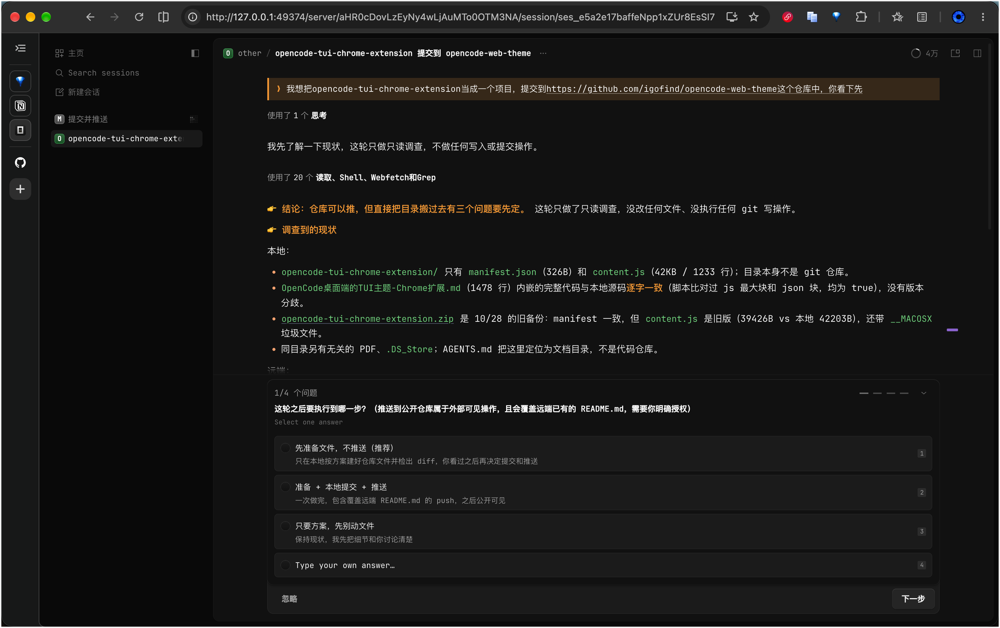

# opencode-web-theme

给 OpenCode 的 Web 界面套上 TUI 风格的 Chrome 扩展，并在聊天区右侧加一条用户提示词刻度导航。

这份 README 面向想直接使用或自行改样式的人：前半部分是安装和生效范围，后半部分是改端口、调参数、验证和已知限制。代码只有 `manifest.json` 和 `content.js` 两个文件，不需要构建、不需要依赖，也不访问外网或向任何外部服务上传数据。

> 扩展依赖 OpenCode 前端内部的 `data-component`、`data-slot` 等属性选择器。OpenCode 版本升级后 DOM 结构变化会导致样式或导航失效，本项目不承诺长期兼容。

## 它做了什么

- 全局等宽字体（JetBrains Mono 栈）、去掉外层 shell 内边距、消息列宽设为可用区域的 90%。
- 浅色 / 深色两套 TUI 配色，跟随应用外观（`data-color-scheme`），未写入时跟随系统外观。
- 重排 Markdown 正文、标题、代码块和表格（偶数行斑马纹）；用户消息改成 `❯ ` 前缀的直角块，去掉气泡和卡片。
- 思考、Shell、工具执行等次要信息统一降灰，字号比正文小一档。
- 隐藏应用自带的 `message-nav`，在聊天区右侧加一条竖直居中的刻度条：每个用户提示词一个刻度，悬停约 0.25 秒跳转，当前条高亮。跳转会借用应用自身的 `#message-<id>` 路由，目标行未渲染时再自行滚动加载历史。

## 效果示例

截图来自 `http://127.0.0.1:49374` 的实际页面，随 OpenCode 版本变化可能略有差异。

### 深色模式（整体效果）



图中可见：`❯ ` 前缀的用户消息直角块、橙色标题与强调、降灰的思考 / Shell 次要信息，以及聊天区右侧竖直居中的提示词刻度条（右缘的紫色短横）。

<!--
追加截图时沿用上面的小节结构：

### <主题名>


一句话说明这张图展示什么。

图片统一放在 screenshots/ 下，用相对路径引用；建议英文文件名、保留 PNG 原图。
-->

## 安装

1. 打开 Chrome 的 `chrome://extensions/`，开启右上角「开发者模式」。
2. 点「加载已解压的扩展程序」，选择本仓库根目录（含 `manifest.json` 的那一层）。
3. 打开或刷新 `http://127.0.0.1:49374`。

扩展未发布到 Chrome Web Store，只能本地加载。

## 生效范围

| 环境 | 地址 | 生效方式 |
| --- | --- | --- |
| 浏览器网页 | `http://127.0.0.1:49374` | 扩展自动注入 |
| 桌面端应用窗口 | `oc://renderer/…` | 在应用 DevTools 控制台手动执行 `content.js` 全文 |
| 其他 | 其他端口 / 其他主机 / `https` / `localhost` | 不处理 |

Chrome 的 match pattern 不支持端口，所以 `manifest.json` 里匹配的是 `http://127.0.0.1/*`，真正的地址判断在 `content.js` 开头（网页看协议、主机、端口，桌面端看 `oc:` 协议）。桌面端是 Electron 窗口，Chrome 扩展进不去。

### 桌面端手动执行

1. 在桌面端应用里打开开发者工具，切到 Console。
2. 首次粘贴会提示「Don't paste code you don't understand」，先输入 `allow pasting` 回车。
3. 把 `content.js` 全文粘贴执行。桌面端 `<head>` 已存在，脚本会立即注入样式。

手动执行的脚本只在当前窗口有效，重启应用或重载窗口后要再贴一次；脚本会作用于全部 `oc://renderer/…` 页面（含设置页）。若控制台报 CSP 相关的样式注入错误，说明应用页面策略不允许插入 `<style>`，脚本无法绕过。

## 端口不是 49374 时

端口 `49374` 和主机 `127.0.0.1` 在源码里写死了 5 行，全部要改：

| 文件 | 行 | 现在的内容 |
| --- | --- | --- |
| `manifest.json` | 3 | `"name": "OpenCode TUI Style (127.0.0.1:49374)"` |
| `manifest.json` | 5 | `"description": "在 http://127.0.0.1:49374 上注入 OpenCode 的 TUI 风格。"` |
| `content.js` | 13 | `location.port === "49374"` |
| `content.js` | 960 | `const host = "127.0.0.1:49374";` |
| `content.js` | 1001 | `const url = "http://127.0.0.1:49374" + path;` |

另外两处不必改：

- `manifest.json` 第 8 行的 `matches` 是 `http://127.0.0.1/*`，Chrome 不允许在 match pattern 里写端口。
- `content.js` 开头和 `navFetch` 上方注释里的地址只是说明文字，可选同步。

改完后在 `chrome://extensions/` 点扩展的刷新按钮，再刷新页面。

## 可调参数

都在 `content.js` 顶部：

| 参数 | 默认值 | 说明 |
| --- | --- | --- |
| `SESSION_WIDTH` | `"90%"` | 列宽上限；想更窄可改 `"80%"` 或固定 `"1100px"` |
| `BODY_FONT_SIZE` | `"15px"` | 正文和输入框字号 |
| `BODY_LINE_HEIGHT` | `"1.6"` | 正文行高 |
| `SECONDARY_FONT_SIZE` | `"13.5px"` | 思考、Shell、工具执行的字号 |
| `UI_FONT` | JetBrains Mono 栈 | 全局字体 |
| `USER_PREFIX` | `"❯ "` | 用户消息前缀，改成 `""` 可去掉 |

两套主题色分别定义在 CSS 的 `:root` 和 `:root[data-color-scheme=dark]` 里。改完后在 `chrome://extensions/` 刷新扩展并刷新页面。

## 验证

在 `http://127.0.0.1:49374` 的控制台执行：

```js
document.getElementById("oc-tui-style")
```

应返回 `<style id="oc-tui-style">`。

正文颜色（深色应为 `rgb(250, 250, 250)`，浅色应为 `rgb(26, 26, 26)`）：

```js
getComputedStyle(document.querySelector("[data-component=markdown]")).color
```

输入框字号（应为 `15px`）：

```js
getComputedStyle(document.querySelector("[data-component=composer-editor]")).fontSize
```

导航内部状态会镜像到 `<html data-oc-nav>`：

```js
document.documentElement.dataset.ocNav
```

形如 `nav-15 | n=19 | seed=done | shown=1 | right=63`。content script 跑在隔离世界，页面控制台读不到 `window.__ocUserNav`；桌面端手动粘贴时可用 `__ocUserNav.debug()` 查看更详细的状态。控制台还会打印 `[oc-nav] 已加载 nav-15`，确认跑的是当前这版。

## 关于本地服务请求和密码

打开会话时，为了把刻度一次铺出来，脚本会向**本机**的 OpenCode 服务发请求：

- 优先从页面最近的接口请求（`performance.getEntriesByType("resource")`）里取会话 id；取不到时请求一次 `/api/session/active`。
- 用会话 id 请求 `/api/session/<id>/message?limit=200&order=desc`，取其中用户消息作为刻度。更早的提示词跟随滚动继续累积，不做全量拉取。补全失败会重试，最多 8 次、间隔 1.5 秒。

应用自身发请求时会带 `Authorization: Basic`（用户名固定 `opencode`），浏览器不会缓存这份凭据，所以脚本按顺序找密码：

1. 地址里的 `auth_token` 参数；
2. `localStorage` 里的「服务器连接」配置；
3. 都找不到时弹一次 `window.prompt`（提示 `opencode service get password`），留空则跳过补全，退回「滚到哪累积到哪」。

密码只存在该页面的 `localStorage`（键 `oc-user-nav-password`），`oc-user-nav-auth-asked` 记录是否已经问过，避免反复弹窗。想清除已存密码，在页面控制台执行 `localStorage.removeItem("oc-user-nav-password")` 即可。

脚本不向任何外部服务器发送数据，`manifest.json` 也没有声明 `host_permissions` 或其他 API 权限；样式注入和上述本地请求都在 `127.0.0.1` 这一台机器上完成。

## 已知限制

- 主机和端口写死，换环境要按上文改 5 行。
- 依赖 OpenCode 内部 DOM 属性，应用改版可能失效。
- 桌面端必须手动执行脚本，且重启后失效；应用 CSP 禁止插入 `<style>` 时无法生效。
- 首屏补全一次性拉取 200 条消息（实测约 1.3MB，在主线程解析），是主要的一次性开销。
- 脚本用 `MutationObserver` 监听 DOM 变化（150ms 去抖），只在匹配的页面上运行。

## 停用

在 `chrome://extensions/` 里关闭或移除扩展，然后刷新页面。桌面端刷新窗口或重启应用即可——手动注入的样式只存在于当前窗口，没有落到磁盘。

## 许可证

MIT，见 [LICENSE](LICENSE)。
